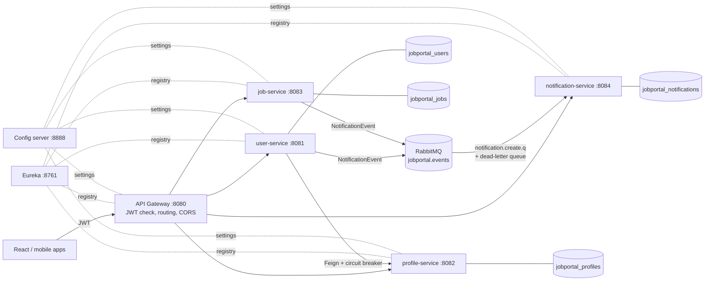

# oneKampus Jobs — Microservices

The job portal's Spring Boot monolith ([`../backend_springBoot`](../backend_springBoot), still the live API) split into
microservices. **Same URLs and JSON**, so the React, Angular, Next.js and mobile apps work unchanged: only their API base
URL points at the gateway.



## Services

| Module | Port | Owns | Talks to |
|---|---|---|---|
| `infra/api-gateway` | 8080 | Routing (`/auth`, `/users`, `/profiles`, `/jobs`, `/notification`), JWT check, CORS | Eureka |
| `infra/discovery-server` | 8761 | Eureka service registry | – |
| `infra/config-server` | 8888 | All settings (`src/main/resources/config/*.yml`) | – |
| `services/user-service` | 8081 | Accounts, login (JWT), OTP, password reset — DB `jobportal_users` | profile-service (Feign), RabbitMQ |
| `services/profile-service` | 8082 | Profiles, saved jobs — DB `jobportal_profiles` | – |
| `services/job-service` | 8083 | Jobs, applications, interview pipeline — DB `jobportal_jobs` | RabbitMQ |
| `services/notification-service` | 8084 | In-app notifications — DB `jobportal_notifications` | RabbitMQ (consumer) |
| `libs/*` | – | Shared errors, ID sequences, caller identity, event contracts, JWT, Feign client | – |

**Design choices**
- **Database per service** (one MongoDB server, four databases). No service reads another's data.
- **Sync where the caller needs an answer:** registration calls profile-service through OpenFeign + Eureka, wrapped in a
  Resilience4j circuit breaker (clear "try again" error when it's down).
- **Async where it doesn't:** "job posted", "interview scheduled" and "password reset" are RabbitMQ events; a failed message
  is retried 3 times, then parked in `notification.create.dlq`. A broker outage never fails the user's action.
- **Security at the edge:** only the gateway checks JWTs (same tokens as the monolith). It removes any `X-User-*`
  headers a client sends and adds the real caller; services sit on a private Docker network. `/internal/**` is not routed.

## Run it

Needs Docker (Docker Desktop or Colima) and Java 17.

```bash
./scripts/up.sh      # builds jars, starts 9 containers, waits until all services are registered
./scripts/e2e.sh     # 32 end-to-end checks through the gateway
./scripts/down.sh    # stop (add --volumes to delete data)
```

- API gateway: http://localhost:8080 · Eureka: http://localhost:8761 · RabbitMQ: http://localhost:15672 (guest/guest)
- Settings: copy `.env.example` to `.env` (JWT secret, MongoDB Atlas URI, Gmail for OTP mail, gateway port).
  Without mail settings the OTP is printed in `docker compose logs user-service`.
- Memory: about 1.5 GB for the whole stack (each JVM capped by its container limit).
- Postman: import `oneKampus-Jobs-Microservices.postman_collection.json` and run "Login" first.

**Point the React app at it:** `REACT_APP_API_URL=http://localhost:8080 npm start` in
`JobFrontendApp/JobWebApp/frontend_ReactJs`.

## Move data from the monolith

```bash
# preview
SOURCE_URI="<monolith MongoDB URI>" SOURCE_DB=jobportal TARGET_URI=mongodb://localhost:27018 DRY_RUN=1 \
  mongosh --nodb --quiet --file tools/migrate-monolith-data.js
# copy (FORCE=1 replaces data already in the target)
SOURCE_URI="<monolith MongoDB URI>" SOURCE_DB=jobportal TARGET_URI=mongodb://localhost:27018 \
  mongosh --nodb --quiet --file tools/migrate-monolith-data.js
```

IDs are kept (profile links, applicants and notifications still match), sequences continue after the highest ID, and
passwords stay bcrypt hashes, so everyone logs in as before. Keep `TZ=UTC` (the live monolith's container timezone).

## What changed compared with the monolith

Same behaviour for the apps, plus these fixes found while splitting it:

| Monolith | Microservices |
|---|---|
| `/users/changePass` reset **any** account's password with just an email | Needs a verified, unexpired OTP for that email, usable once |
| Any logged-in user could update **any** profile | Owner or admin only |
| `postedBy` / `applicantId` taken from the request body (spoofable) | Taken from the verified token |
| Anyone logged in could read anyone's job history, posted jobs and notifications | Own data only (admins excepted) |
| Applicant IDs compared with `==` on `Long`: duplicates allowed and status changes ignored for user IDs above 127 | Compared by value |
| Notification writes inside the request | RabbitMQ events with retries and a dead-letter queue |

## Branches

Built step by step on `backend-micro-01` … `backend-micro-10`, each merged into `backend-microservices`:
01 foundation (Maven parent, shared libs) · 02 platform (Eureka, config, gateway) · 03 user-service ·
04 profile-service · 05 job-service · 06 notification-service + RabbitMQ · 07 gateway JWT security ·
08 Docker Compose · 09 data migration · 10 docs and tests.
